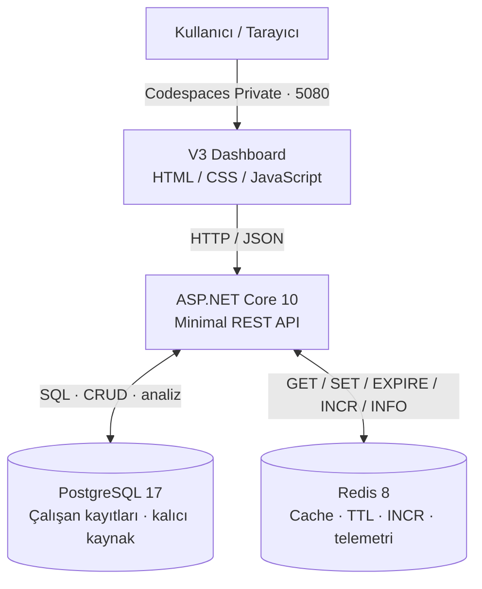
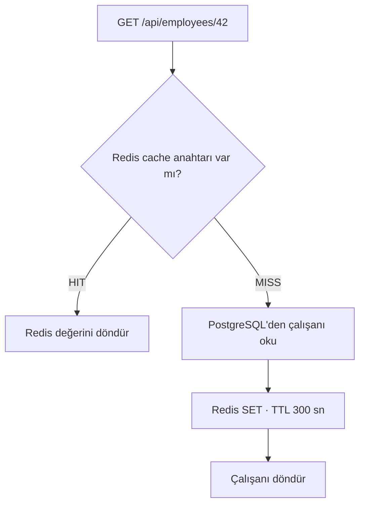

# Redis HR Lab V3 · People Intelligence

**ASP.NET Core 10 · PostgreSQL 17 · Redis 8 · Docker Compose**

10.000 sentetik çalışan kaydıyla **personel yönetimi**, **veri analitiği** ve **Redis cache performansı** deneyebileceğin web uygulaması. Çalışan ekleyebilir, bilgilerini güncelleyebilir, kayıt silebilir; Redis'in cache HIT/MISS, TTL, INCR ve bellek metriklerini canlı gözlemleyebilirsin.

> [!IMPORTANT]
> **Demo / geliştirme ortamı:** Giriş ekranı, kimlik doğrulama veya rol bazlı erişim kontrolü yoktur. Codespaces'te **5080 portunu Private** tut. Gerçek çalışan ve maaş bilgisi ekleme.

## 🚀 1. Hızlı başlangıç

### GitHub Codespaces'te çalıştır

1. [Redis-DotNet-Lab repository'sini](https://github.com/Emocancell/Redis-DotNet-Lab) aç.
2. **Code → Codespaces → mevcut Codespace → Open in Browser** yolunu izle.
3. **Terminal → New Terminal** aç ve aşağıdaki komutları sırayla çalıştır:

```bash
cd /workspaces/Redis-DotNet-Lab
docker compose up --build -d
docker compose ps
```

`postgres` ve `redis` için **healthy**, `api` için **Up** beklenir. İlk kurulumda Docker imajları ve .NET paketlerinin indirilmesi gerekebilir.

**Dashboard'u aç:** Codespaces alt paneli → **Bağlantı Noktaları (Ports)** → **5080** → **İletilen Adres**. Görünürlük **Private** kalsın.

**Servislerin gerçekten bağlı olduğunu doğrula:**

```bash
curl -sS http://localhost:5080/api/status | python3 -m json.tool
```

Yanıtta `"postgresOnline": true`, `"redisOnline": true` ve başlangıç veri kümesi için `"totalEmployees": 10000` görmeyi beklersin. Yeni çalışan eklediysen toplam farklı olabilir.

**Entegrasyon testlerini çalıştır:**

```bash
python3 scripts/smoke_test.py
```

Başarıyla tamamlanırsa son satır `PASS V3:` ile başlar. Test sırasında tek bir sentetik deneme çalışanı oluşturulur, güncellenir, sonra silinir; Redis demo sayacı da bir artırılır.

### Sonraki gün uygulamayı yeniden açmak

```bash
cd /workspaces/Redis-DotNet-Lab
docker compose up -d
```

Port **5080** bağlantısını tekrar açman yeterli. Kod değiştiyse `docker compose up --build -d` kullan.

### Günlük kullanılan komutlar

| İşlem | Komut |
|---|---|
| Başlat | `docker compose up -d` |
| Kodla birlikte yeniden derle | `docker compose up --build -d` |
| Durumları kontrol et | `docker compose ps` |
| .NET API logları | `docker compose logs --tail=100 api` |
| Canlı log akışı | `docker compose logs -f api` |
| Servisleri geçici durdur | `docker compose stop` |
| Durdurulan servisleri başlat | `docker compose start` |
| Container'ları kaldır, **volume'ları koru** | `docker compose down` |

> [!CAUTION]
> **`docker compose down -v` çalıştırma.** `-v`, PostgreSQL ve Redis volume'larını da kaldırarak kaydedilmiş demo verilerini silebilir.

### Repo'nun en güncel kodunu almak

```bash
git status --short
git pull origin main
docker compose up --build -d
```

`git pull` yerel değişiklikler nedeniyle hata verirse, değişikliklerini incelemeden `git reset --hard` kullanma.

### İlk kurulum ve V2'den yükseltme aynı şey değildir

- **Yeni, boş PostgreSQL volume'uyla kurulum:** `docker compose up --build -d` ilk başlatmada `db/init.sql` ile 10.000 sentetik çalışanı oluşturur.
- **Mevcut V2 veritabanını V3'e yükseltme:** Bir kere `bash scripts/deploy_v3.sh` kullan. Script PostgreSQL yedeği alır, `003_employee_crud.sql` migration'ını uygular, build/test yapar ve test başarılıysa GitHub'a push etmeyi dener. **Normal her çalıştırmada bu komutu tekrar kullanma.**

## 🧩 2. Projede neler var?

| Modül | Yapabileceklerin |
|---|---|
| **Genel Bakış** | Çalışan sayısı, ortalama brüt maaş, toplam aylık maaş yükü, uygulama cache HIT oranı |
| **Çalışan Yönetimi** | Kayıt ekleme, düzenleme, silme, arama, departman/cinsiyet filtresi, sayfalama |
| **Personel Analitiği** | Departman dağılımı, ortalama yaş, sentetik cinsiyet dağılımı |
| **Redis Lab** | İlk çağrıda cache MISS, tekrarda HIT; cache warm-up/reset |
| **Redis Telemetri** | `INFO memory`, `INFO stats`, `DBSIZE`, keyspace HIT/MISS, eviction ve expiration |
| **Key Inspector** | Redis anahtarı, kalan TTL ve saklanan değerin boyutu |
| **Atomik Sayaç** | `INCR` ile atomik artırma ve 600 saniyelik TTL |
| **Benchmark** | PostgreSQL ve Redis sorgu sürelerinin ortalama/P95 karşılaştırması |
| **Arayüz** | Açık/koyu tema, PostgreSQL'den taze veri yenileme, işlem bildirimleri |

Yeni çalışan kaydında **ad, soyad, yaş, cinsiyet, departman, unvan, brüt maaş ve işe giriş tarihi** girilebilir. Tüm personeller **sentetik demo verisidir**; cinsiyet, gerçek kişilerin isimlerinden tahmin edilmez.

## 🏗️ 3. Sistem mimarisi



**Sorumluluklar:** PostgreSQL çalışan bilgilerinin **kalıcı veri kaynağıdır (source of truth)**. Redis, sık okunan verilerin kısa süreli kopyalarını ve demo sayacını tutar. API, iki sistemle konuşur; frontend yalnızca HTTP üzerinden API'yi çağırır.

> **Codespaces mimari notu:** Bu repository'nin `compose.yaml` dosyası, daha önce yaşanan Docker ağ bağlantısı sorunu nedeniyle Redis ve API'yi PostgreSQL ile **aynı network namespace'inde** çalıştırır. Bu geliştirme ortamına özel çözümdür; üretimde ayrı container ağları, kimlik doğrulama ve güvenli yapılandırma tercih edilmelidir.

### Cache-aside: neden ikinci sorgu hızlı olabilir?



| Veri türü | Redis TTL |
|---|---:|
| Tekil çalışan cache'i | **300 saniye** |
| Dashboard özet cache'i | **60 saniye** |
| Demo atomik sayaç | **600 saniye** |

**Cache geçersizleştirme:** Çalışan ekleme/düzenleme/silme sonrasında `hrlab:epoch` sürümü artırılır; böylece eski cache anahtarları kullanılmaz ve kendi TTL'leri dolduğunda temizlenir. Bu işlem Redis'i `FLUSHDB` ile sıfırlamaz.

## ⚡ 4. Redis özelliklerini terminalden dene

Aşağıdaki örnekler **Codespaces terminalinde** çalıştırılır.

**A. İlk sorgu MISS, ikinci sorgu HIT**

```bash
curl -sS -X POST http://localhost:5080/api/cache/reset
curl -sS http://localhost:5080/api/employees/42
curl -sS http://localhost:5080/api/employees/42
```

Yanıtların `source` alanı sırasıyla `PostgreSQL` ve `Redis` olmalıdır.

**B. Bellek, anahtar sayısı ve TTL**

```bash
curl -sS http://localhost:5080/api/redis/stats | python3 -m json.tool
curl -sS http://localhost:5080/api/cache/inspect/42 | python3 -m json.tool
```

**C. Redis atomik INCR**

```bash
curl -sS http://localhost:5080/api/redis/counter
curl -sS -X POST http://localhost:5080/api/redis/counter/increment
```

**D. PostgreSQL / Redis benchmark**

```bash
curl -sS 'http://localhost:5080/api/benchmark/42?runs=25' | python3 -m json.tool
```

> Bu **tek istemcili sentetik testtir**. Üretim throughput'u veya SLA sonucu olarak yorumlanmamalıdır.

## 🔌 5. REST API

| Yöntem | Endpoint | Görevi |
|---|---|---|
| `GET` | `/api/status` | PostgreSQL/Redis durumu + uygulama HIT/MISS |
| `GET` | `/api/summary?fresh=true` | Cache yerine taze PostgreSQL özeti |
| `GET` | `/api/employees?page=1&pageSize=12` | Listeleme, arama ve filtreleme |
| `GET` | `/api/employees/42` | Tekil çalışan cache-aside sorgusu |
| `POST` | `/api/employees` | Çalışan ekleme |
| `PUT` | `/api/employees/{id}` | Tüm çalışan alanlarını güncelleme |
| `DELETE` | `/api/employees/{id}` | Çalışan silme |
| `PATCH` | `/api/employees/{id}/salary` | Geriye uyumlu maaş güncelleme |
| `GET` | `/api/redis/stats` | Redis bellek/INFO/DBSIZE |
| `GET` | `/api/cache/inspect/42` | Cache anahtarı, kalan TTL ve boyut |
| `POST` | `/api/cache/warmup?count=100` | Toplu cache yükleme |
| `POST` | `/api/cache/reset` | Cache namespace sürümünü artırma |
| `GET` | `/api/benchmark/42?runs=25` | Ortalama ve P95 gecikme testi |
| `GET` | `/api/redis/counter` | Demo sayaç ve TTL |
| `POST` | `/api/redis/counter/increment` | Atomik `INCR` |

**Örnek: API'den sentetik çalışan ekle**

```bash
curl -sS -X POST http://localhost:5080/api/employees \
  -H 'Content-Type: application/json' \
  -d '{"firstName":"Ece","lastName":"Demo","age":28,"gender":"Kadın","department":"Yazılım","position":"Yazılım Mühendisi","salary":85000,"startDate":"2025-09-01"}'
```

Bu istek PostgreSQL'de **yeni bir demo kaydı** oluşturur. Aynı işlem web arayüzündeki **Yeni çalışan** butonuyla da yapılabilir.

## 📁 6. Kaynak kod dizini

```text
Redis-DotNet-Lab/
├── .github/workflows/ci.yml            # GitHub Actions smoke test
├── db/
│   ├── init.sql                         # 10.000 sentetik çalışanı ilk kurulumda oluşturur
│   └── migrations/
│       ├── 002_fix_demo_names.sql       # V2: demo isim tutarlılığı
│       └── 003_employee_crud.sql        # V3: otomatik ID sequence
├── scripts/
│   ├── deploy_v3.sh                     # V2 → V3 yükseltme / yedek / test / push
│   └── smoke_test.py                    # V3 entegrasyon testi
├── src/RedisLab.Api/
│   ├── Program.cs                       # API, cache, telemetri, sorgular
│   ├── HrManagementEndpoints.cs         # POST / PUT / DELETE endpoint'leri
│   ├── RedisLab.Api.csproj              # .NET paketleri
│   └── wwwroot/
│       ├── index.html                   # Dashboard
│       ├── dashboard-v3.js              # Butonlar, formlar ve HTTP istekleri
│       └── dashboard-v3.css             # Açık / koyu tema
├── Dockerfile
├── compose.yaml
└── README.md
```

## 🛠️ 7. Sorun giderme

| Belirti | İlk bakılacak yer |
|---|---|
| Dashboard açılmıyor | `docker compose ps` ve Codespaces **5080 / Private** bağlantısı |
| Panel boş veya yenileme başarısız | `curl -sS http://localhost:5080/api/status` |
| HTTP 500 | `docker compose logs --tail=100 api` |
| Tarayıcı eski temayı gösteriyor | `Ctrl+Shift+R`, `dashboard-v3.js/css` dosyalarının yüklenmesi |
| Redis bağlantı sorunu | `docker compose exec redis redis-cli PING` |
| PostgreSQL veri sayısı | `docker compose exec postgres psql -U lab -d redislab -c 'SELECT count(*) FROM employees;'` |
| GitHub Actions kırmızı X | [Actions sekmesi](https://github.com/Emocancell/Redis-DotNet-Lab/actions) → başarısız test logu |

**Redis Insight (isteğe bağlı):**

```bash
docker compose --profile tools up -d redisinsight
```

Codespaces'te **5540** portunu **Private** aç. Mevcut ortak network namespace yapısında Redis bağlantı adresi `127.0.0.1:6379` olarak kullanılabilir.

**PostgreSQL yedeği al:**

```bash
mkdir -p "$HOME/redis-hr-backups"
docker compose exec -T postgres pg_dump -U lab -d redislab -Fc > "$HOME/redis-hr-backups/redislab-manual.dump"
```

## 🔒 8. Güvenlik ve geliştirme sınırları

Bu sistem bir **eğitim/demonstrasyon projesidir**. Gerçek personel verisi için gerekli kimlik doğrulama, yetkilendirme, şifre/TLS yönetimi, erişim denetim kayıtları ve kurumsal güvenlik kontrolleri bulunmaz. Yalnızca sentetik verilerle, izole ortamda çalıştır.

PostgreSQL kalıcı veri kaynağıdır; Redis cache verileri geçicidir. `scripts/smoke_test.py` bir deneme çalışanını oluşturup değiştirerek siler; `INCR` sayacı bir kez artar. GitHub Actions testlerinin geçip geçmediğini ilgili commit üzerinden ayrıca doğrula.
